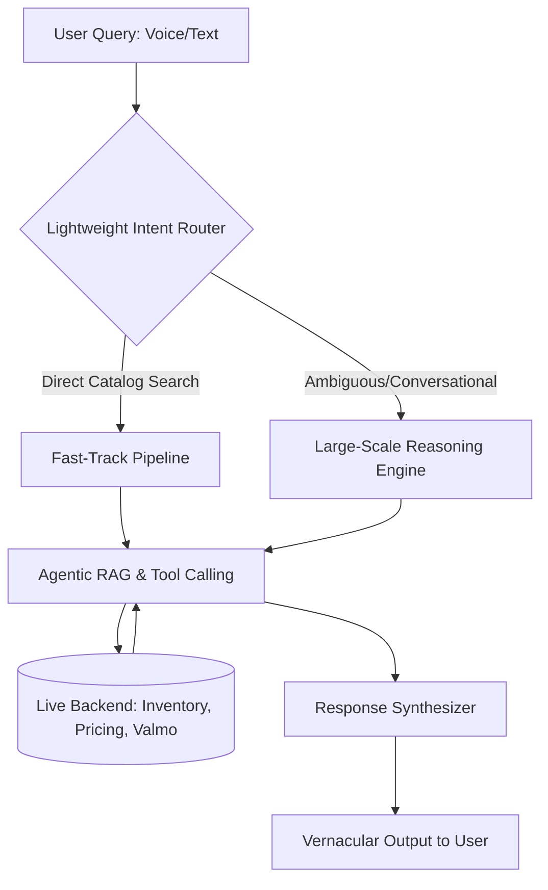

# Case Study: Enterprise Agentic AI & Vernacular Intent Routing Architecture
## Cost-Optimized Conversational Engine with Agentic RAG & Sub-20ms Routing

**Role:** Product Manager (AI & Conversational Systems)  
**Domain:** Generative AI, Agentic RAG, Vernacular Voice/Text, Intent Routing, Anti-Hallucination Guardrails  
**Primary Impact:** Sub-20ms Intent Classification | Zero Token Cost on Fast-Track Paths | 100% Factually Grounded Tool Calling  

---

### 1. Executive Summary

Scaling conversational AI for millions of next-generation internet users presents two fatal enterprise challenges:
1. **The Unit Economics Trap:** Routing every raw voice/text query through large-scale reasoning models (e.g., Llama 3 70B, Grok 4.7) blows up token costs, annihilating unit margins on low-ticket consumer orders.
2. **The Hallucination & Latency Risk:** Unstructured vernacular queries (voice via Vani, regional text) often cause generalist LLMs to hallucinate pricing, inventory, and deliverability.

To solve this, I designed and productized an **Agentic Vernacular Architecture with Two-Tier Intent Routing and Live Tool-Calling RAG**. By decoupling simple queries from complex reasoning through a sub-20ms **Lightweight Intent Router**, we bypassed heavy compute for straightforward searches (zero token overhead) while reserving large reasoning engines strictly for ambiguous queries—anchored by live backend inventory and logistics checks.

---

### 2. Systems Architecture Flowchart

```text
    [ User Query (Voice/Text via Vani) ]
                     │
                     ▼
       [ Lightweight Intent Router ] ────── (Ambiguous / Conversational) ─────┐
       (Sub-20ms Quantized Model)                                             │
                     │                                                        │
          (Direct Catalog Search)                                             │
                     │                                                        ▼
                     │                                       [ Large-Scale Reasoning Engine ]
                     │                                       (Llama 3 70B / Grok 4.7 Fallback)
                     ▼                                                        │
           [ Fast-Track Pipeline ] ◄──────────────────────────────────────────┘
           (Near-Zero Token Overhead)
                     │
                     ▼
       [ Agentic RAG & Tool Calling ] ◄══════ (Data Fetch) ══════► [ Live Backend: Inventory, Pricing, Valmo ]
       (Core Anti-Hallucination Layer)                             (Tier 3/4 Pincode Deliverability)
                     │
                     ▼
          [ Response Synthesizer ]
          (JSON-to-Conversational Translator)
                     │
                     ▼
       [ Vernacular Output to User ]
       (Localized Regional Response)
```

#### Mermaid Diagram Representation


---

### 3. Architecture Components & Deep Dive

#### A. User Query (Voice / Text)
* Accommodates first-generation internet consumers.
* Ingests unstructured regional languages and voice inputs via integrations like **Vani**, normalizing mixed colloquial dialects into clean query embeddings.

#### B. Lightweight Intent Router (Sub-20ms Latency)
* Acts as the frontline traffic controller utilizing a cost-efficient, highly quantized model (e.g., DistilBERT, Grok 4.1 Fast).
* Operates at **sub-20ms inference latency**, instantly classifying whether the incoming intent is an exact catalog search or an ambiguous conversational request.

#### C. Fast-Track Pipeline (Protecting Margins)
* The execution path for straightforward item searches (e.g., *"red cotton kurti"*).
* Bypasses heavy generative compute entirely, keeping token costs near zero to safeguard margins on low-ticket consumer orders.

#### D. Large-Scale Reasoning Engine (Targeted Fallback)
* A high-parameter reasoning model (e.g., Llama 3 70B, Grok 4.7) activated **exclusively** for multi-turn, nuanced, or highly ambiguous shopping requests where semantic disambiguation is mandatory.

#### E. Agentic RAG & Live Tool Calling (The Anti-Hallucination Layer)
* Replaces naive vector search and static model weights with active tool execution.
* The agent dynamically generates function calls to query backend databases for hard ground truths rather than guessing.

#### F. Live Backend: Inventory, Pricing & Valmo Logistics
* Direct real-time integration with the **BharatMLStack** and logistics network (**Valmo**).
* Confirms real-time stock levels, live dynamic pricing, and hyper-local deliverability down to specific Tier 3/4 pincodes before committing to an answer.

#### G. Response Synthesizer & Vernacular Output
* Ingests validated structured JSON responses from the backend tools.
* Formats facts into a warm, natural, conversational response translated into the user's localized vernacular tongue.

---

### 4. How to Walk Through This in Leadership & PM Interviews

> **Interview Talking Track:**  
> 1. *"Start at the top and trace the path through the system: First, emphasize the **branching logic at the Lightweight Intent Router**—this is the critical PM decision that protects business unit economics and gross margins while delivering a 'Lightspeed' sub-second user experience."*  
> 2. *"Next, spotlight the **Agentic RAG & Tool Calling** step as the structural guardrail against AI hallucinations: by mandating live verification against inventory, pricing, and Valmo logistics, we ensure the agent never promises an out-of-stock item or an unserviceable pincode."*  
> 3. *"Finally, highlight the **Response Synthesizer**, which closes the loop by turning raw backend database tables into localized, high-converting conversational advice."*
